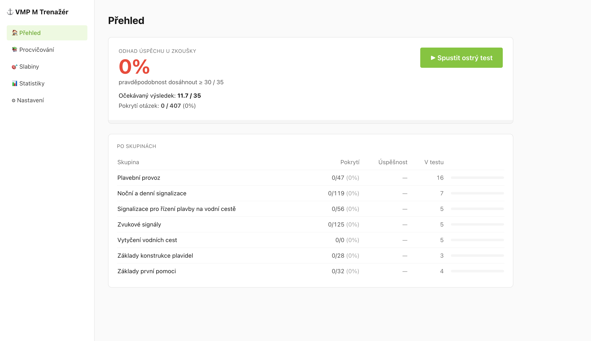

# VMP M Trenažér

Webová appka na trénink otázek pro zkoušku VMP M (Vůdce malého plavidla, kategorie M 2015).



## Architektura

- Frontend: Vite + React 19 SPA
- API: Hono + Drizzle ORM nad libSQL (SQLite dialect)
- Auth: session cookie + argon2; uživatelé se registrují sami (email + heslo + captcha Cloudflare Turnstile),
  přihlásí se přes Google / Seznam (OAuth 2.0), případně se zakládají přes CLI
- Deploy: Vercel + Turso (free), nebo single-container Docker (SQLite v volume)

## Setup (jednorázově)

```bash
pnpm install
pnpm scrape                        # stáhne otázky a obrázky ze spspraha.cz
cp .env.example .env.local
pnpm db:migrate                    # vytvoří data/app.db
pnpm user:add <email>              # založí prvního uživatele
```

## Registrace (Cloudflare Turnstile)

Kdokoli si může založit účet na `/register` - stačí email, heslo (≥ 8 znaků) a
projít captchou [Cloudflare Turnstile](https://developers.cloudflare.com/turnstile/).
Turnstile je zdarma a nenastavuje sledovací cookies. Registrace je zapnutá jen
když jsou nastavené oba klíče:

```bash
TURNSTILE_SITE_KEY=...      # veřejný, posílá se do prohlížeče přes /api/auth/config
TURNSTILE_SECRET_KEY=...    # tajný, jen na serveru
```

- Klíče získáš v Cloudflare dashboardu: Turnstile → Add widget, doména appky
  (a `localhost` pro lokální vývoj), režim „Managed".
- Pro lokální vývoj stačí testovací klíče z `.env.example`, které vždy projdou
  (widget zobrazí upozornění, že jde o test).
- Když některý klíč chybí, registrace je vypnutá: `/register` to oznámí a odkaz
  „Vytvořit účet" zmizí. Uživatele pak zakládáš jen přes `pnpm user:add`.
- Server ověří token u Cloudflare (`siteverify`) ještě před kontrolou, jestli
  email už existuje. `POST /api/auth/register` je navíc rate-limitovaný
  (5 pokusů / 15 min / IP).

## Přihlášení přes Google a Seznam

Tlačítka „Pokračovat přes Google/Seznam" přihlásí existujícího uživatele a při prvním
použití mu rovnou založí účet (bez hesla). Captcha (Turnstile) se tu nevyžaduje.
Poskytovatel je zapnutý, jen když má nastavené obě proměnné; jinak tlačítko zůstane
neaktivní s textem „připravujeme".

```bash
GOOGLE_CLIENT_ID=...
GOOGLE_CLIENT_SECRET=...
SEZNAM_CLIENT_ID=...
SEZNAM_CLIENT_SECRET=...
APP_URL=https://vmp.example.cz     # veřejná adresa appky, z ní se skládá redirect URI
```

Redirect URI, které je potřeba zaregistrovat u poskytovatele:

- `<APP_URL>/api/auth/oauth/google/callback`
- `<APP_URL>/api/auth/oauth/seznam/callback`

Lokálně (bez `APP_URL`) se použije adresa, na které běží Vite, tedy
`http://localhost:5400/api/auth/oauth/<provider>/callback`. `APP_URL` nastav vždy v produkci
a za reverse proxy, jinak se adresa odvodí z requestu a nemusí sedět.

Registrace aplikací:

- Google: [Google Cloud Console](https://console.cloud.google.com/apis/credentials) → OAuth client ID,
  typ „Web application", scopes `openid` a `email`.
- Seznam: [vyvojari.seznam.cz/oauth/admin](https://vyvojari.seznam.cz/oauth/admin), scope `identity`.
  Seznam redirect URI vždy přepíše na https, výjimkou je jen `localhost`.

Jak se účty párují:

- Účty od poskytovatele jsou v tabulce `oauth_identities` a hledají se podle stabilního ID
  (Google `sub`, Seznam `oauth_user_id`), ne podle emailu. Změna emailu u Googlu tedy nevadí.
- Při prvním přihlášení s **ověřeným** emailem, který už má existující účet, se poskytovatel
  připojí k tomuto účtu (heslo dál funguje). Google posílá `email_verified`; Seznam takový
  příznak nemá, takže za ověřené bereme jen jeho vlastní schránky (`@seznam.cz`, `@email.cz`,
  `@post.cz`, ...).
- Neověřený email se k účtu neuloží vůbec, aby se přes něj nedal později převzít cizí účet.
- Účty založené přes Google/Seznam nemají heslo a přihlášení heslem na ně nefunguje.

## Spuštění (lokálně)

```bash
pnpm dev                           # vite + hono současně
```

http://localhost:5400 — frontend (Vite). Vite proxy posílá `/api/*` do Hono na portu 3001.

## Deploy: Vercel + Turso

1. Založit Turso DB: `turso db create vmp` + token: `turso db tokens create vmp`.
2. Na Vercelu nastavit env vars:
   - `DATABASE_URL=libsql://<db>-<org>.turso.io`
   - `DATABASE_AUTH_TOKEN=<token>`
   - `SESSION_COOKIE_SECURE=true`
   - `TURNSTILE_SITE_KEY=<site key>`, `TURNSTILE_SECRET_KEY=<secret key>` (viz Registrace)
   - volitelně `APP_URL` a `GOOGLE_*` / `SEZNAM_*` (viz [Přihlášení přes Google a Seznam](#přihlášení-přes-google-a-seznam))
3. `vercel deploy`. Build step (`vercel.json`) spustí `pnpm db:migrate` a pak `pnpm build`.
   API funkce běží ve Frankfurtu (`"regions": ["fra1"]` ve `vercel.json`), Turso DB je v `aws-eu-west-1`
   (Irsko). Bez nastavení regionu by Vercel pouštěl funkce v USA (`iad1`).
4. Uživatele zakládat lokálně proti hostované DB:
   ```bash
   DATABASE_URL=libsql://... DATABASE_AUTH_TOKEN=... pnpm user:add <email>
   ```

## Deploy: Docker (self-host)

```bash
docker build -t vmp-trainer -f docker/Dockerfile .
docker run -d -p 3000:3000 -v $(pwd)/data:/data vmp-trainer
docker exec -it <container> pnpm user:add <email>
```

Volume `/data` drží SQLite soubor — přežije restart.

Pro zapnutí registrace přidej do `docker run` `-e TURNSTILE_SITE_KEY=... -e TURNSTILE_SECRET_KEY=...`.
Pro přihlášení přes Google/Seznam přidej `-e APP_URL=https://...` a `-e GOOGLE_CLIENT_ID=...`
atd. (viz [Přihlášení přes Google a Seznam](#přihlášení-přes-google-a-seznam)).

## Skripty

| Skript | Co dělá |
|---|---|
| `pnpm dev` | dev server (vite + hono) |
| `pnpm dev:vite` | jen frontend |
| `pnpm dev:api` | jen API |
| `pnpm build` | produkční build do `dist/` |
| `pnpm test` | spustí vitest |
| `pnpm scrape` | scraper otázek (obě kategorie M + C) |
| `pnpm scrape:M` / `pnpm scrape:C` | scraper jen pro vybranou kategorii |
| `pnpm db:generate` | generuje migrace z drizzle schema |
| `pnpm db:migrate` | aplikuje migrace |
| `pnpm user:add <email>` | založí uživatele z CLI (interaktivně se zeptá na heslo); alternativa k registraci přes `/register` |
| `pnpm package-skill` | zazipuje skill `explain-vmp-question` (pro batch generování vysvětlení) |

## Kategorie zkoušky (M, C)

Appka podporuje dvě kategorie zkoušky:

- **M** — Vůdce malého plavidla (vnitrozemí), 407 otázek, ostrý test 35/30 min, ≥ 30 / 35
- **C** — Příbřežní plavba na moři, 215 otázek, ostrý test 28/25 min, ≥ 24 / 28

Mezi kategoriemi se přepíná dropdownem v sidebaru (desktop) nebo dropdown badge v topbaru (mobil). Aktivní kategorie persistuje v `localStorage`.

## Skill (jen pro generování vysvětlení)

`explain-vmp-question` (v `.claude/skills/`) — interaktivní vysvětlení jedné otázky v Claude Code. Akceptuje `--test M|C` v helper skriptu.

`batch-explain-vmp-questions` (v `.claude/skills/`) — orchestrace hromadného generování přes Workflow fan-out (jeden subagent na otázku). Aktivuj v Claude Code přirozeným jazykem ("vygeneruj chybějící explanations pro C").

V samotné appce se skilly nepoužívají — appka jen servíruje statické HTML soubory.

## Módy

- **Ostrý test** — počty otázek a timer podle aktivní kategorie (M: 35 / 30 min, C: 28 / 25 min)
- **Procvičování** — buď struktura ostrého testu (bez timeru), nebo vlastní výběr oblastí
- **Slabiny** — automaticky vybere otázky které pleteš v aktivní kategorii
- **Statistiky** — záložky [M] [C] [Všechny]

Progress je v DB (libSQL), per-uživatel. Vysvětlení jsou statické HTML soubory committnuté v `public/explanations/`.
